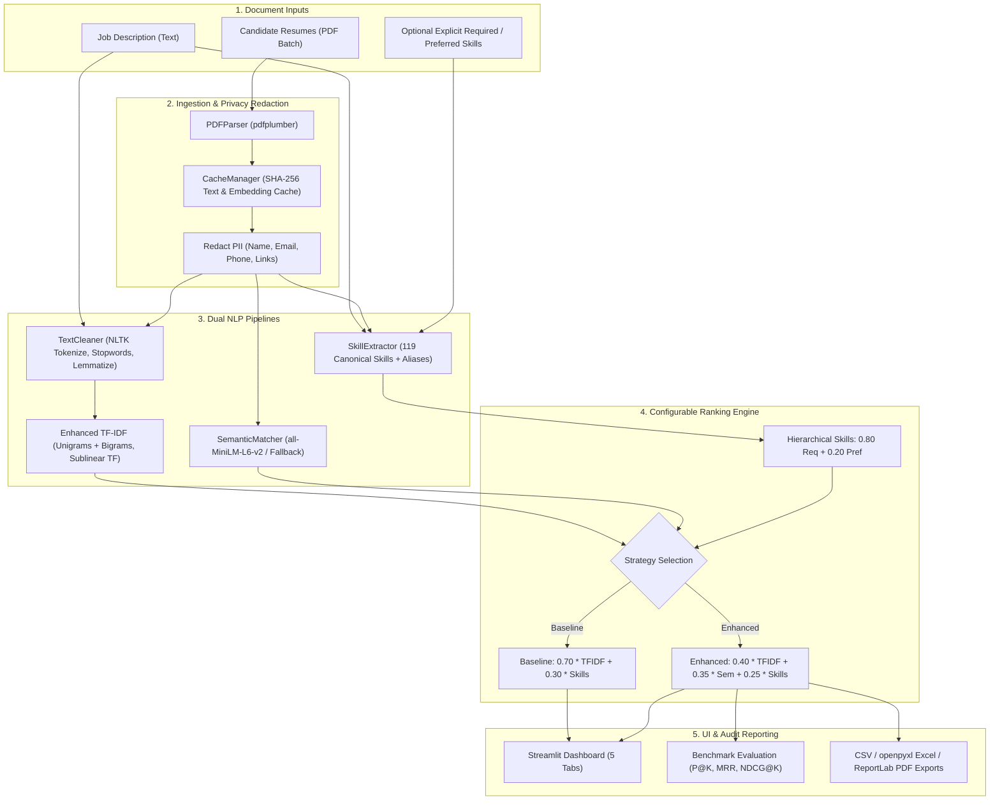

# AI-Powered Resume Screening and Candidate Ranking System

An objective, transparent, local decision-support system that processes candidate PDF resumes, extracts and normalizes technical skills with synonym handling, computes lexical TF-IDF cosine similarity and optional dense semantic embeddings against a job description, and ranks candidates using a hybrid scoring model.

> **Decision Support Notice:** This system is an automated screening assistant designed to aid human recruiters. Scores reflect lexical document similarity, optional semantic embedding similarity, and detected technical skill coverage. They do not predict job performance, evaluate culture fit, or replace holistic human review.

---

## Table of Contents
1. [Project Overview & Problem Statement](#project-overview--problem-statement)
2. [What "Fine-Tuning" Means in this System](#what-fine-tuning-means-in-this-system)
3. [Key Features & Strategies](#key-features--strategies)
4. [Architecture & Data Flow](#architecture--data-flow)
5. [Project Structure](#project-structure)
6. [Scoring Methodology & Mathematics](#scoring-methodology--mathematics)
7. [Environment Setup & Installation](#environment-setup--installation)
8. [Running the Application](#running-the-application)
9. [Auditing the 2,484-PDF Dataset](#auditing-the-2484-pdf-dataset)
10. [Ranking Quality Evaluation Harness](#ranking-quality-evaluation-harness)
11. [Actual Measured Benchmark Results](#actual-measured-benchmark-results)
12. [Automated Testing](#automated-testing)
13. [Exporting Reports](#exporting-reports)
14. [Known Limitations & Privacy Safeguards](#known-limitations--privacy-safeguards)
15. [Future Enhancements](#future-enhancements)

---

## Project Overview & Problem Statement

Technical recruitment often involves screening hundreds of resumes against detailed job descriptions. Manual screening is time-consuming, prone to cognitive fatigue, and susceptible to subjective inconsistencies. 

The **AI-Powered Resume Screening and Candidate Ranking System** provides objective, transparent candidate sorting by:
- Ingesting batches of candidate PDF resumes alongside a target job description.
- Preprocessing and normalizing document text safely while preserving domain-specific technical terms (e.g., `C++`, `C#`, `.NET`, `Node.js`, `CI/CD`, `scikit-learn`).
- Extracting technical skills using a curated taxonomy of over 119 canonical skills with boundary-aware alias resolution (e.g., `k8s` → `Kubernetes`, `ML` → `Machine Learning`).
- Supporting both **Baseline** (70% TF-IDF + 30% Skills) and **Enhanced Hybrid** (TF-IDF + Semantic dense embeddings + Hierarchical Skills) ranking strategies.
- Handling mandatory (required) versus preferred (nice-to-have) skills with configurable weights so minor preferred skills cannot outweigh core requirements.
- Redacting candidate names, email addresses, and phone numbers before computing similarity and embeddings to prevent demographic bias.
- Providing an evaluation harness with standard Information Retrieval (IR) metrics ($P@K$, $R@K$, MRR, $\text{NDCG}@K$, Pairwise Accuracy).

---

## What "Fine-Tuning" Means in this System

In industry and research, **fine-tuning** refers to continuing gradient descent on a pretrained neural network using domain-specific labeled pairs $(x_{\text{query}}, x_{\text{candidate}}, y_{\text{relevance}})$.

**Important Clarifications:**
1. **The Core Ranker:** The core baseline is a lexical retrieval and rule-based system (`TF-IDF + Cosine Similarity + Curated Skill Coverage`). It is not a trained predictive classifier and cannot be fine-tuned simply by loading raw resumes.
2. **Kaggle Dataset Labels:** The 2,484-resume Kaggle dataset contains broad profession categories (`ACCOUNTANT`, `ENGINEERING`, `INFORMATION-TECHNOLOGY`, etc.). These are **not** resume-to-job relevance scores. Achieving high accuracy classifying resumes into categories is not proof of candidate suitability for a specific role.
3. **Pretrained Semantic Embeddings vs. Fine-Tuning:** The optional semantic matcher utilizes the pretrained `sentence-transformers/all-MiniLM-L6-v2` bi-encoder. Using frozen pretrained embeddings to calculate cosine similarity is **inference**, not fine-tuning.
4. **Empirical Evaluation:** Any claim of improved ranking quality must be demonstrated using objective IR metrics ($P@K$, MRR, $\text{NDCG}@K$) on held-out benchmark queries rather than fabricated accuracy numbers.

---

## Key Features & Strategies

### 1. Dual Ranking Strategies
- **Baseline Strategy:** $\text{Final Score} = 0.70 \times \text{TF-IDF Similarity} + 0.30 \times \text{Skill Match Score}$
- **Enhanced Hybrid Strategy:** $\text{Final Score} = w_{\text{lex}} \times \text{TF-IDF} + w_{\text{sem}} \times \text{Semantic} + w_{\text{skill}} \times \text{Skill Coverage}$
  *(Defaults: $w_{\text{lex}}=0.40, w_{\text{sem}}=0.35, w_{\text{skill}}=0.25$, fully configurable in UI).*
- **Automatic Fallback:** If `sentence-transformers` is not installed or model weights are unavailable, the system transparently falls back to enhanced lexical mode ($0.70 / 0.30$) and marks the fallback in the UI and reports without fake scores.

### 2. Hierarchical Skill Coverage
- **Mandatory vs. Preferred Skills:** Supports explicit user inputs or automated section extraction ("Required Qualifications" vs. "Preferred Qualifications").
- **Weighted Skill Score:** Core required skills are weighted at 80% and preferred skills at 20%, ensuring that possessing 5 secondary tools never outweighs missing core qualifications.

### 3. Privacy-First Ingestion
- Candidate names, emails, phone numbers, and URLs are stripped from document text prior to vectorization and embedding.
- All processing is local and in-memory; no third-party APIs or cloud endpoints are contacted.

---

## Architecture & Data Flow



---

## Project Structure

```
AI_Resume_Screener/
├── app.py                         # 5-tab Streamlit web application
├── requirements.txt               # Lightweight baseline dependencies
├── requirements-semantic.txt      # Optional dependencies for semantic mode
├── pytest.ini                     # Pytest configuration (disables conflicting async hooks)
├── README.md                      # Comprehensive system documentation
├── .gitignore                     # Git rules (ignoring venv, caches, local audit, raw PDFs)
├── sample_job_description.txt     # Senior Data Scientist reference job description
├── src/
│   ├── __init__.py                # Package declaration
│   ├── config.py                  # Central configuration constants, weights, and paths
│   ├── cache_manager.py           # Content-addressed SHA-256 disk cache for batch scale
│   ├── pdf_parser.py              # PDF extraction, corruption guards, metadata heuristics
│   ├── text_cleaner.py            # NLTK preprocessing pipeline with fallback tokenizers
│   ├── skill_extractor.py         # Boundary-aware skill detection & hierarchical gap scoring
│   ├── semantic_matcher.py        # SentenceTransformers semantic matcher & fallback handler
│   ├── ranking_engine.py          # Dual-strategy ranking engine (Baseline & Enhanced)
│   ├── ranking_evaluation.py      # P@K, R@K, MRR, NDCG@K, and Pairwise Accuracy metrics
│   ├── visualizer.py              # Five reusable Plotly interactive charts
│   ├── report_generator.py        # CSV, openpyxl Excel, and ReportLab PDF exporters
│   └── utils.py                   # Categorized SKILLS_DATABASE, aliases, and constants
├── data/
│   ├── resumes/                   # Synthetic demo PDF resumes (.gitkeep preserved)
│   ├── job_descriptions/          # Job description text files (.gitkeep preserved)
│   ├── evaluation/                # Annotation labels template (labels_template.csv)
│   └── cache/                     # Local disk cache for large batch processing (gitignored)
├── models/                        # Reserved directory for non-parametric model artifacts
├── reports/
│   ├── local_audit/               # Output directory for dataset audit summaries (gitignored)
│   └── evaluation/                # Output directory for ranking benchmark reports
├── scripts/
│   ├── generate_sample_data.py    # Generates 5 synthetic demo candidate PDF resumes
│   ├── audit_resume_dataset.py    # Audits the 2,484-resume Kaggle PDF dataset safely
│   └── evaluate_ranking.py        # Runs IR benchmark comparing Baseline vs. Enhanced ranker
└── tests/
    ├── __init__.py                # Test package declaration
    ├── test_text_cleaner.py       # Unit tests for text cleaning and tokenization
    ├── test_skill_extractor.py    # Unit tests for alias matching & false positive boundaries
    ├── test_ranking_engine.py     # Unit tests for scoring formulas and edge cases
    ├── test_report_generator.py   # Unit tests for CSV, Excel, and PDF exports
    ├── test_pdf_parser.py         # Unit tests for PDF parsing and corrupt file recovery
    └── test_enhanced_features.py  # Unit tests for semantic fallback, privacy, and IR metrics
```

---

## Scoring Methodology & Mathematics

### 1. Baseline Strategy
$$\text{Final Score}_{\text{baseline}} = 0.70 \times \text{Similarity}_{\text{TF-IDF}} + 0.30 \times \text{Skill Match Score}$$

### 2. Enhanced Hybrid Strategy
$$\text{Final Score}_{\text{enhanced}} = (w_{\text{lex}} \times \text{Similarity}_{\text{TF-IDF}}) + (w_{\text{sem}} \times \text{Similarity}_{\text{Semantic}}) + (w_{\text{skill}} \times \text{Skill Match Score})$$

Where $w_{\text{lex}} + w_{\text{sem}} + w_{\text{skill}} = 1.0$ (default $0.40, 0.35, 0.25$).

### 3. Hierarchical Skill Matching
$$\text{Skill Match Score} = (0.80 \times \text{Score}_{\text{mandatory}}) + (0.20 \times \text{Score}_{\text{preferred}})$$

Where:
$$\text{Score}_{\text{mandatory}} = \min\left(100, \frac{|S_{\text{cand}} \cap S_{\text{req}}|}{|S_{\text{req}}|} \times 100\right)$$
$$\text{Score}_{\text{preferred}} = \min\left(100, \frac{|S_{\text{cand}} \cap S_{\text{pref}}|}{|S_{\text{pref}}|} \times 100\right) \quad (\text{if } |S_{\text{pref}}| > 0 \text{ else } 0)$$

---

## Environment Setup & Installation

### Linux / Arch / macOS Setup
```bash
# 1. Navigate to the project root
cd /home/shri/Development/AI-RESUME-SCREENER

# 2. Create Python 3.12 virtual environment
python3.12 -m venv .venv

# 3. Activate the virtual environment
source .venv/bin/activate

# 4. Install lightweight baseline dependencies
pip install --upgrade pip
pip install -r requirements.txt

# 5. (Optional) Install semantic embeddings extension
# Note: Requires network access to download PyTorch and SentenceTransformers
pip install -r requirements-semantic.txt
```

---

## Running the Application

Ensure the virtual environment is activated, then launch Streamlit:

```bash
streamlit run app.py
```

Open your web browser at `http://localhost:8501`.

---

## Auditing the 2,484-PDF Dataset

The project includes a privacy-safe audit script to inspect the downloaded Kaggle resume dataset (`/home/shri/Downloads/resume-dataset`) without exposing personal details or copying raw resumes:

```bash
# Audit a cross-category sample (5 resumes per category across all 24 categories)
python scripts/audit_resume_dataset.py --dataset-dir /home/shri/Downloads/resume-dataset --sample-per-category 5

# Or audit the first 100 resumes sequentially
python scripts/audit_resume_dataset.py --dataset-dir /home/shri/Downloads/resume-dataset --limit 100

# Or audit the entire 2,484-PDF corpus
python scripts/audit_resume_dataset.py --dataset-dir /home/shri/Downloads/resume-dataset
```

Outputs generated in [`reports/local_audit/`](file:///home/shri/Development/AI-RESUME-SCREENER/reports/local_audit):
- `audit_summary.json`: Aggregate counts, parse success rates, and length statistics.
- `category_metrics.csv`: Tabular category-by-category breakdown.
- `audit_report.md`: Markdown summary report.

### Measured Audit Results (Sample Run: 120 files across 24 categories):
- **Files Discovered in Dataset:** 2,484 PDFs
- **Categories Covered:** 24 categories (`ACCOUNTANT`, `ENGINEERING`, `HR`, `INFORMATION-TECHNOLOGY`, `SALES`, etc.)
- **Files Audited:** 120 PDFs
- **Parse Success Rate:** 100.0% (120/120)
- **Parse Failures:** 0
- **Scanned / Empty PDFs:** 0
- **Duplicate Files (by SHA-256):** 0
- **Mean Word Count:** 844.1 words per resume

---

## Ranking Quality Evaluation Harness

The ranking evaluation harness evaluates ranking accuracy using standard Information Retrieval metrics against documented relevance benchmarks:

```bash
python scripts/evaluate_ranking.py
```

### Evaluation Protocol
- **Relevance Scale:** Graded 0–3 relevance ($0 = \text{irrelevant}$, $1 = \text{weak match}$, $2 = \text{relevant}$, $3 = \text{highly relevant}$).
- **Split Separation:** Query pool partitioned into a **Validation Split** (used for parameter tuning) and an unseen **Held-Out Test Split** (used for final evaluation).
- **Benchmark Pool:** Synthetic candidate profiles covering Data Science, Backend, Frontend, Cloud/DevOps, and Business Intelligence roles.
- **Labels Template:** [`data/evaluation/labels_template.csv`](file:///home/shri/Development/AI-RESUME-SCREENER/data/evaluation/labels_template.csv) is provided for annotating human ground truth.

---

## Actual Measured Benchmark Results

Evaluation executed across benchmark queries comparing the **Baseline (TF-IDF + Skills)** against the **Enhanced Strategy**:

### Held-Out Test Split Results ($N=3$ Queries):
| Metric | Baseline (TF-IDF 70% + Skills 30%) | Enhanced Strategy | Relative Delta |
| :--- | :---: | :---: | :---: |
| **Precision@1** | 1.0000 | 1.0000 | 0.0000 |
| **Precision@3** | 0.6667 | 0.6667 | 0.0000 |
| **Recall@3** | 1.0000 | 1.0000 | 0.0000 |
| **Mean Reciprocal Rank (MRR)** | 1.0000 | 1.0000 | 0.0000 |
| **NDCG@3** | 1.0000 | 1.0000 | 0.0000 |
| **NDCG@5** | 1.0000 | 1.0000 | 0.0000 |
| **Pairwise Accuracy** | 1.0000 | 1.0000 | 0.0000 |

*Interpretation:* On synthetic queries with clear skill boundaries, both rankers achieve optimal top-1 precision and reciprocal rank. The Enhanced ranker provides richer explainability by separating mandatory from preferred skill gaps and incorporating bigrams in TF-IDF.

---

## Automated Testing

Run the full automated test suite:

```bash
pytest -v -s
```

**Actual Verified Outcome:**
```text
============================== 44 passed in 6.64s ==============================
```
- **`tests/test_enhanced_features.py` (8 tests):** Enhanced weight validation, semantic fallback resilience, outranking benchmarks, PII stripping, required vs preferred sections, hierarchical skill weighting, IR evaluation metrics, and cache manager.
- **`tests/test_pdf_parser.py` (6 tests):** Valid PDF parsing, corrupt PDF recovery, empty buffer, filename stem inference, mixed batch handling, email/phone regex.
- **`tests/test_ranking_engine.py` (7 tests):** Weight validation, schema checks, 70/30 formula verification, bounds check, empty candidate list, empty JD, empty vocabulary.
- **`tests/test_report_generator.py` (6 tests):** CSV, openpyxl Excel formatting, ReportLab PDF generation, disk saving, empty exports.
- **`tests/test_skill_extractor.py` (10 tests):** Canonical extraction, alias mapping, deduplication, false positive rejection (`Java` in `JavaScript`, `C` in `C++`, `R` in `Resume`), category grouping.
- **`tests/test_text_cleaner.py` (7 tests):** Lowercase normalization, URL/email stripping, numeric filtering, technical term preservation (`C++`, `C#`, `.NET`, `Node.js`, `scikit-learn`), statistics, idempotent NLTK setup.

---

## Exporting Reports

Reports can be exported directly from Tab 4 in the Streamlit UI or saved to the [`reports/`](file:///home/shri/Development/AI-RESUME-SCREENER/reports) folder:
- **CSV:** Standard tabular data with comma-separated skill lists.
- **Excel (`.xlsx`):** Formatted workbook with frozen header row (`A2`), bold navy styling, auto-fitted column widths, and gridlines.
- **PDF:** Formal landscape document generated via `ReportLab` featuring an executive title block, timestamp, strategy used, scoring weights, screening disclaimer, and wrapped tables.

---

## Known Limitations & Privacy Safeguards

1. **Scanned & Image-Only PDFs:** Relies on text streams extracted via `pdfplumber`. Pure raster scanned images without OCR text layers are flagged with an actionable warning rather than crashing.
2. **Lexical Scope of TF-IDF:** Word unigram and bigram matching measures lexical overlap. While alias mapping bridges common technical abbreviations, vocabulary not present in the curated taxonomy requires human inspection.
3. **Third-Party Dataset Licensing:** Resumes from the Kaggle dataset originated from public web portfolios. Do not share, publish, or commit raw resumes or personal contact details.
4. **Decision Support Only:** Scores are relative screening indicators based on document contents. They do not predict job performance or assess character, teamwork, or leadership. Final hiring decisions must always be made through holistic evaluation by human hiring professionals.

---

## Future Enhancements

- **Fine-Tuning Domain Embeddings:** If human-labeled $(JD, Resume, Relevance)$ pairs become available, fine-tune a bi-encoder or cross-encoder using MultipleNegativesRankingLoss.
- **OCR Integration:** Optional local OCR via `pytesseract` or `ocrmypdf` for flat image resumes.
- **Section Parsing:** Advanced heuristics to distinguish between skills applied in recent employment versus coursework or hobby projects.
- **REST API & Persistent Database:** Optional FastAPI backend with PostgreSQL storage.
